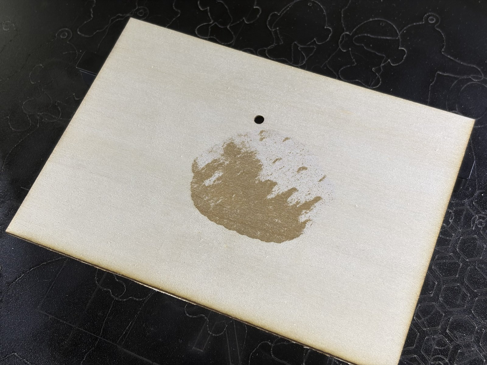
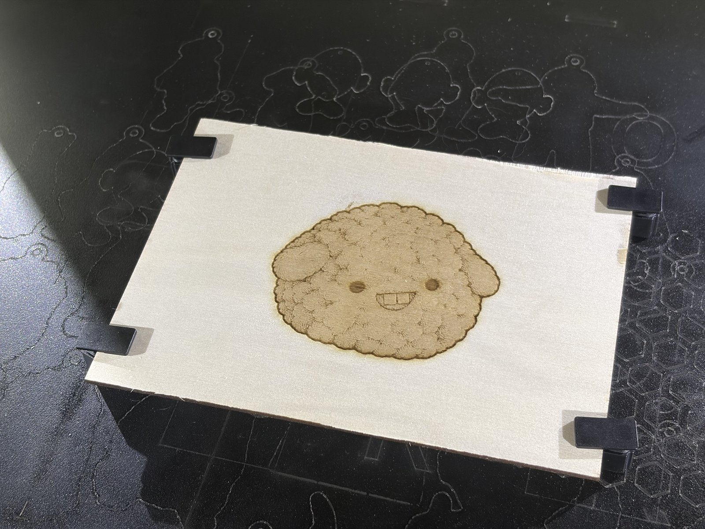

# xTool M2 曲面加工焦点修复 · xTool M2 curved-surface focus (Z) fix

| 修复前 Before | 修复后 After |
|---|---|
|  |  |

左图：曲面模式，填充雕刻 15%，焦点偏高，一半没烧到。右图：同一台机器、同一种板，数据修正后刻的。
Left: curved-surface mode, fill engraving at 15 %, focus too high, half of it did not mark. Right: same machine and board type after the correction.

[中文](#中文) · [English](#english)

---

## 中文

### 问题

xTool Studio 1.9.11 + M2 设备插件（JS002）0.2.4，用「曲面材料加工」模式时，机器头比「激光平面加工」模式高了 **5.7 mm**（同一块材料、同一个高度）。焦点停在材料表面上方，轻扫、浅灰度这类低功率雕刻会一块烧得到、一块烧不到，甚至几乎不出痕迹。

固定木板、重新测曲面、减少测量点、做设备自带的校准，都改变不了这个数：它来自插件的计算方式。

### 怎么查出来的

1. **同一块板、同一个点，中间没开盖：**
   - 平面模式自动测厚是 13.247 mm，曲面测量记下的高度是 18.931，多了 5.684；
   - 换一块板再测：14.547 对 20.194，多了 5.647。
2. **G 代码里的 Z（越大机器头越低）：**
   - 平面模式 Z = 26.086 − 板厚。例如板厚 13.021 时 Z = 13.065，板厚 10.31 时 Z = 15.775。
   - 曲面模式 Z = 26.086 − 曲面高度。13.25 mm 高的板，曲面给出 Z 7.16，平面会给 12.84。
3. **插件代码**（`%APPDATA%\xTool Studio\atomm\exts\JS002\index.js`）：
   - 曲面测量每个点：`z = getZDistance() − 测距 + Sg`，其中 `Sg` 返回 5.7；
   - 生成曲面任务：`z_max = getZDistance() − Sg`，机器头高度 Z = z_max − z；
   - 两步合起来 Z = 测距 − 2 × 5.7。平面模式是 测距 − 5.7，所以多扣了一次 5.7。
   - `getZDistance()`（机器头标定值）在两步里前后抵消了，所以校准改不了它。

### 修复思路

不改 Studio、不改插件，只改曲面测量的结果文件 `%APPDATA%\xTool Studio\atomm\curve\surface.txt`。每次点「加工」，Studio 都会把这个文件复制进任务文件夹，任务用的就是改过的数据。

补多少不是写死的：
1. 有平面读数就按实测补。读数要求：同一块板，测曲面之前在平面模式点自动化「启动」量的厚度，中间没开盖，测点在曲面测量区里。偏差 = 曲面高度 − 平面厚度。
2. 没有平面读数，就读插件代码里实际加的那个数（现在是 5.7）。插件更新改了这个数，补的量跟着变。
3. 安全规矩：
   - 曲面测高了，要把机器头往下放，这有可能撞板。所以只有实测值和插件里的数差 1 mm 以内，才自动补，否则停下来弹窗。
   - 曲面测低了，是往上抬，不会撞，按实测直接补。
   - 差 0.3 mm 以内不改；差 15 mm 以上当读数有问题，不改。
   - 每次修改前先备份；同一份数据不会改两次。

### 使用

需要：Windows，Python 3.9 以上（只用标准库），已安装 xTool Studio。

```
python curve_z_fix.py check       看插件状态、当前曲面数据、实测偏差（只读）
python curve_z_fix.py fix         需要时修正当前曲面数据（--dry-run 只演练不写）
python curve_z_fix.py verify      点「加工」之后，确认这一单用的是修正过的数据
python curve_z_fix.py watch       常驻后台：每次测完曲面自动修正，每出一单曲面任务自动核对，有问题弹窗
python curve_z_fix.py install     开机自动运行 watch（在「启动」文件夹放一个 .vbs），并马上启动
python curve_z_fix.py uninstall   去掉开机启动（正在运行的需要自己结束 pythonw.exe 或注销）
```

推荐流程：
1. 材料放好、关盖。在平面模式标签点一次自动化「启动」（拍照＋测厚）。这一步可选，但有了它，偏差就是按实测算的。
2. 切到曲面模式测曲面，期间不要开盖。
3. watch 在运行就会自动修正；没运行就手动执行 `fix`。
4. 点「加工」，执行 `verify`（watch 会自动做），显示 OK 再按机器上的按钮。

文件位置：备份、记录、日志在 `%LOCALAPPDATA%\xtool-m2-curve-z-fix`；`surface.txt` 旁边会多一个 `surface.txt.zfix.json` 标记。

### 测过的版本

xTool Studio 1.9.11（Windows，中文界面）、M2 插件 JS002 0.2.4、固件 40.141.012.01.ht05、455 nm 40 W 激光头、Python 3.13。插件一更新，脚本会重新判断：读不懂新代码、又没有平面读数时，它不修改，只弹窗提醒。

### 免责声明

非 xTool 官方工具，风险自负。脚本不会启动加工，也不会移动机器。出光前请人在机器旁，自己确认参数和高度。发现这个问题后，请同时向 xTool 反馈，这只是官方修好之前的临时办法。不要同时运行两份。

---

## English

### Problem

With xTool Studio 1.9.11 and the M2 device plugin (JS002) 0.2.4, jobs in **curved surface processing** mode put the laser head **5.7 mm higher** than plane mode does for the same material height. The focus floats above the surface, so light engraving (fills, light grayscale) marks only in places, or hardly at all. Clamping the board, re-measuring, fewer points or the built-in calibrations do not change it; it comes from the plugin's arithmetic.

### Evidence

- Same board, same point, lid kept closed: plane auto-measure 13.247 mm vs curved model 18.931 (+5.684); another board 14.547 vs 20.194 (+5.647).
- G-code Z (larger = head lower): plane `Z = 26.086 − thickness` (13.021 → 13.065, 10.31 → 15.775); curved `Z = 26.086 − model z`, giving 7.16 on a 13.25 mm board where plane mode gives 12.84.
- Plugin code (`%APPDATA%\xTool Studio\atomm\exts\JS002\index.js`):
  - each curved point is stored as `z = getZDistance() − distance + Sg` with `Sg` = 5.7;
  - the curved job uses `z_max = getZDistance() − Sg`, and the head height is `Z = z_max − z`;
  - together `Z = distance − 2 × 5.7`, while plane mode uses `distance − 5.7`;
  - the head calibration `getZDistance()` cancels out, which is why calibration cannot fix it.

### What the script does

It never touches Studio or the plugin. It only corrects the measured model `%APPDATA%\xTool Studio\atomm\curve\surface.txt`, which Studio copies into the job folder every time you click Process.

The correction is a measured variable, not a constant:
1. **Plane reading available:** if there is a plane-mode thickness reading of the same board (automation 「启动」), taken before the curved measurement with the lid kept closed and inside the measured area, the offset is `model z − thickness`.
2. **No reading:** the offset the installed plugin adds is read from its code each time.
3. **Safety:**
   - Lowering the head (model too high) only happens when both agree within 1 mm, or from the plugin's number alone when there is no reading.
   - Raising the head (model too low) may come from the measurement alone.
   - Differences under 0.3 mm are left alone, and over 15 mm are refused.
   - The original is always backed up, and the same data is never corrected twice.

### Usage

Requires Windows, Python 3.9+ (standard library only) and xTool Studio.

```
python curve_z_fix.py check       plugin state, current model, measured offset (read only)
python curve_z_fix.py fix         correct the current model if needed (--dry-run to rehearse)
python curve_z_fix.py verify      after clicking Process: did this job use a corrected model
python curve_z_fix.py watch       stay running: correct every new model, check every curved job, warn on problems
python curve_z_fix.py install     run "watch" at logon (a .vbs in the Startup folder) and start it now
python curve_z_fix.py uninstall   remove the logon entry (end the running pythonw.exe yourself or log off)
```

Workflow:
1. Place the material and close the lid. Optionally run plane-mode automation 「启动」 once, so the offset is measured.
2. Measure the curved surface without opening the lid.
3. `watch` corrects the model automatically; otherwise run `fix`.
4. Click Process, then `verify` (`watch` does it too). Press the machine button only when it says OK.

Backups, records and logs: `%LOCALAPPDATA%\xtool-m2-curve-z-fix`. A marker `surface.txt.zfix.json` is written next to `surface.txt`.

### Tested with

xTool Studio 1.9.11 (Windows, Chinese UI), M2 plugin JS002 0.2.4, firmware 40.141.012.01.ht05, 455 nm 40 W laser head, Python 3.13. If a plugin update changes the code and there is no plane reading, the script does not correct anything and shows a warning instead.

### Disclaimer

Not an official xTool tool; use at your own risk. The script never starts a job or moves the machine. Stay at the machine and check settings and height before pressing the button. Please also report the issue to xTool; this is a workaround until it is fixed. Do not run two copies at once.

## License

MIT, see [LICENSE](LICENSE).
